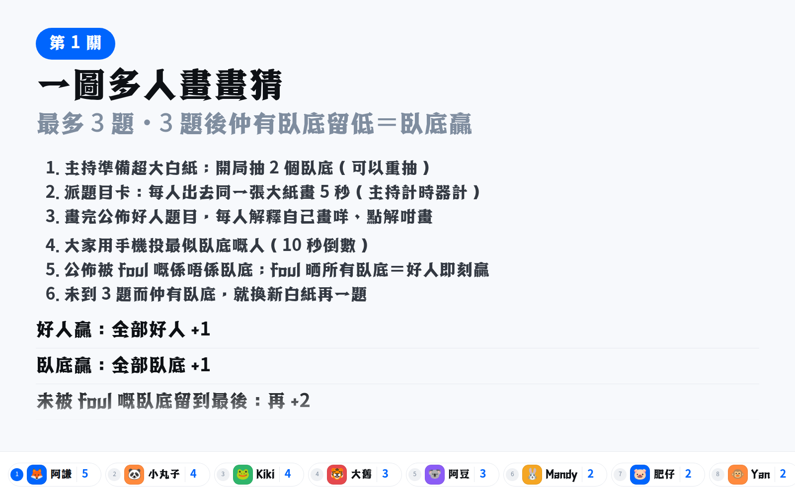
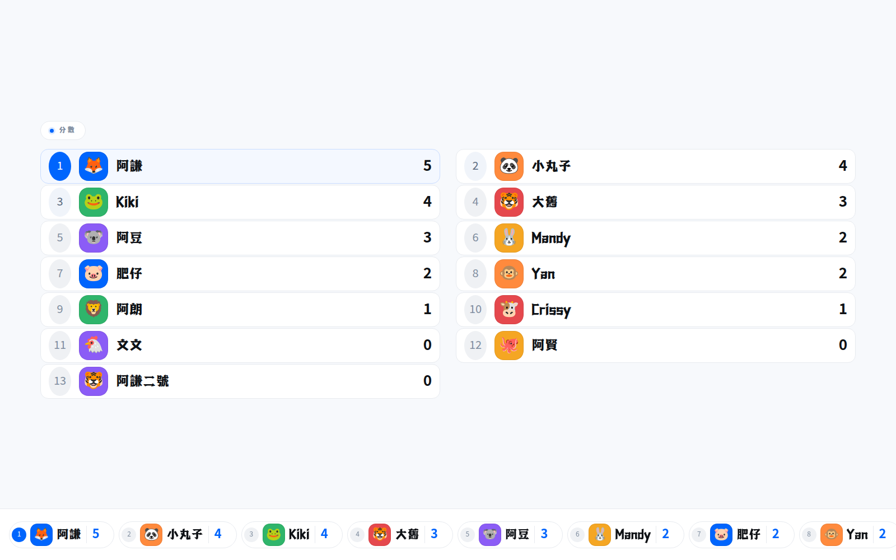
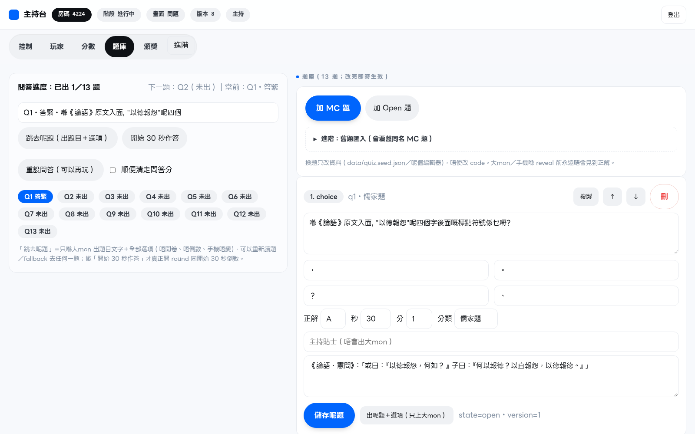

# Blunder_Operation

> 一個為生日派對而設嘅本地多人派對遊戲平台：**一個後端、三個前端（大mon／主持台／手機）、四關遊戲、一套 6 種卡嘅引擎**。
> 派對主題：**《關於我初試策劃圍威喂這檔事》**
> 現時版本：**v0.4.6**（Doubao 淺色視覺 ＋ 大mon 思緒重生體）

## 呢個 repo 係咩

- 全部 TypeScript（strict）＋ Node 26 LTS（fastify + `@fastify/websocket` + `@fastify/static`），單 process。
- 部署目標：Windows server Docker，host port `30005` → 容器 `3000`；對外經 Cloudflare Tunnel（`/host` 同 `/api/host/*` 再加 Cloudflare Access）。
- 四關跟壽星流程：**一圖多人畫畫猜／拍賣時間估歌／笨蛋殺手／問答環節**；每關有規則頁（大mon 入關自動顯示、主持台可編輯）。
- 計分＝**事件帳簿**（加錯用 void 標記作廢，唔刪紀錄）；JSONL journal（manifest＋segment＋sha256＋fsync）做唯一真相，重啟 replay。
- 手機只做單向提交（投票／問答／競投），大mon 唯讀，主持台係唯一可以改大mon 嘅人。

## 四關遊戲（現行 v0.4.x）

| 關 | 玩法 | 計分 |
|---|---|---|
| **一圖多人畫畫猜** | 開局抽 2 個臥底＋3 對題；每人同一張大紙輪流畫 5 秒；公佈好人題目；手機 10 秒投最似臥底；foul 晒所有臥底＝好人即刻贏，3 題後仲有臥底＝臥底贏 | 好人贏全部好人 +1／臥底贏全部臥底 +1／**未被 foul 嘅臥底留到最後再 +2** |
| **拍賣時間估歌** | 大mon 10 秒倒數；手機撳「競投」＝當刻剩餘秒數（最少 1 秒）；**最少秒數先聽，同秒最後撳先**；主持公佈排名、自己播歌、逐位判分 | 答對 +1；答錯去下一位 |
| **笨蛋殺手** | 主持抽 1 老闆＋1 殺手（身份只喺主持台）；紙本執行 3 粒子彈殺兩人；主持揭曉同加分 | 主持手動加分（計入分項結算） |
| **問答環節** | 13 題、30 秒；主持可先出「題目＋選項」唔倒數，準備好先開始作答；先公佈分佈、後公佈答案；Q12 ±2 尺容差、Q13 主持即場入真實答案 | MC 答對 +1；Q13 完全答中 +2 |

結算畫面有**逐關分項矩陣＋總排行榜**，頒獎三個獎：**最高分獎／中庸之道獎（最接近平均數）／多謝參與獎**。

## 功能一覽

| 模組 | 內容 |
|---|---|
| 入場 | 手機掃 QR／用房碼入場，自訂名＋emoji 頭像，主持 approve／踢人；入場後揀頭像唔會清空個名 |
| 流程 | 預設 rundown：一圖多人 → 拍賣 → 笨蛋殺手 → 問答；主持可上一關／跳過／重設流程（返第一關）、逐關規則頁 |
| 計分帳簿 | 逐筆 event、undo／void、換組（跟人走／留原組）、每關 checkpoint、`/api/host/export` CSV＋room.json |
| 一圖多人 | 完整局狀態機（抽身份／重抽／公佈題目／10 秒投票／foul／下一題／結算）；`matchUid` 令重設再玩都唔會漏派分；同票／零票有裁決路徑 |
| 拍賣 | 密封「剩餘秒數」競投、持久提交順序判同秒、排名／判分／完結分開、零人競投可跳下一首、**唔限歌曲數**（`bid.next` 自動建卡） |
| 問答 | 題庫資料化（13 題 seed）、出題目／開始作答／公佈分佈／公佈答案／重設問答；題目監控 panel＋可跳題；舊 payload 兼容 |
| 大mon | Doubao 淺色、思緒重生體（數字 fallback 系統字）、QR＋房碼紙卡、規則頁、倒數 pill、分數板、排行榜、逐關結算、頒獎、ticker；26–30 人自動分欄 |
| 主持台 | 5 個主 tab（控制／玩家／分數／題庫／頒獎）＋「進階」；大mon 同步狀態、鎖定／黑屏、緊急返 QR；流程掣 v0.4.6 統一 2×2 |
| 手機 | 加入／等待批准／身份／投票／問答／競投／出局提示；倒數跟 server 時鐘；PWA meta＋LINE Seed TW 字體 |
| 穩定度 | WS 自動重連＋resync、clock offset（≤0.5s）、`commandId` 冪等、連線 cap、production 拒啟動檢查、render error boundary |

## 架構

```
手機 /play ─┐
大mon /stage ├── WSS /ws（hello 首訊息帶 token） ── 單 process
主持 /host ─┘         │
                     ├── HTTP: /api/join /api/health /api/ready /api/host/*
                     ├── JSONL journal（data/journal/room-*/）
                     └── media（data/media/）
```

- `/stage` `/play` `/ws` 公開；`/host` 同 `/api/host/*` 由 Cloudflare Access＋PIN 雙重保護。
- 狀態機主從：`open → close → tally → reveal`；公開 DTO 同 server 私有模型分開（role-filtered view），臥底身份／臥底題只送主持台。
- 詳細規格：[`docs/PLAN-v3.1.md`](docs/PLAN-v3.1.md)（唯一權威）、[`docs/00-INDEX.md`](docs/00-INDEX.md)、規則頁對照：[`platform/docs/RULES-v0.4.md`](platform/docs/RULES-v0.4.md)。

## 介面

> 以下截圖係 **v0.4.6** 真 browser 截圖（1600×1000 大mon／主持台，430×900 手機）。

| 大mon：入場 QR／房碼 | 大mon：關卡規則頁 |
|---|---|
|  |  |

| 大mon：問答 30 秒 | 大mon：分數板 |
|---|---|
|  |  |

| 主持台：控制 | 主持台：題庫＋題目監控 |
|---|---|
|  |  |

| 手機：入場 | 手機：問答 |
|---|---|
|  |  |

## 快速開始（本機）

需求：Node **26.x**（`engines: >=26 <27`）。

```bash
cd platform
npm ci
npm run build
cp .env.example .env      # 設 PIN（6–12 位數字，唔准用 000000／123456 等 default）
npm start                 # http://localhost:3000/stage  /host  /play
```

開發模式（唔使 build）：

```bash
PIN=246810 NODE_ENV=development npm run dev
```

想本機快速試多幾個玩家，可以開 `AUTO_APPROVE=1`（只限測試；正式場要主持逐個 approve）。

## 測試

```bash
cd platform
npm test                  # node:test：213 個 test，全部綠燈（v0.4.6）
```

`bots/` 保留 M0–M5 壓測／驗收腳本（真 HTTP＋真 WebSocket），需要先起 server：

```bash
BASE=http://127.0.0.1:3000 PIN=246810 node bots/bots.mjs   # 30 bots 併發＋連線 cap
BASE=http://127.0.0.1:3000 PIN=246810 node bots/m1.mjs     # 問答／規則頁
BASE=http://127.0.0.1:3000 PIN=246810 node bots/m2.mjs     # 拍賣＋media deck
BASE=http://127.0.0.1:3000 PIN=246810 node bots/skew.mjs   # 時鐘 skew
BASE=http://127.0.0.1:3000 PIN=246810 node bots/fault.mjs  # fault injection
```

## Docker 部署（Windows server）

```bash
# server 上
cd C:\Users\<user>\hbd\platform
docker compose up -d --build        # ports: 30005:3000
docker compose ps                   # healthy
curl http://127.0.0.1:30005/api/ready
```

- `Dockerfile`：multi-stage（`node:26-alpine` build → runtime 只帶 `dist/`＋production deps）。
- `docker-compose.yml`：`30005:3000`、`./data` `./media` volume、`restart: unless-stopped`、healthcheck `/api/ready`。
- 上線要喺 Cloudflare 做兩條 Access policy（`/host`、`/api/host/*`），再設 `ACCESS_REQUIRED=1` 同正確 `PUBLIC_ORIGINS`。
- Runbook（起機／PIN／房碼／checkpoint／熱點後路／Cloudflare 上線清單）：[`platform/RUNBOOK.md`](platform/RUNBOOK.md)。

## 目錄

```
platform/            # app（TypeScript／Docker）
  src/server         # fastify、WS hub、journal、commands、views
  src/client         # stage／host／play 三端
  src/shared         # protocol／types
  seed/              # 題庫、一圖多人題目、規則頁（純資料）
  bots/              # M0–M5 壓測／驗收腳本
  test/              # node:test unit／integration（213 個）
  docs/RULES-v0.4.md # 四頁規則同 FLOW 對照
  RUNBOOK.md         # 部署／現場 runbook
docs/                # PLAN-v3.1（唯一權威規格）、索引、交付報告
evidence/            # M0–M5 早期原始測試 log
check/               # 模型 review／audit 報告
screenshots/         # v0.4.6 三端截圖
```

## 版本

| 版本 | 重點 |
|---|---|
| v0.1.x | 首個可部署版本：三端、四關、計分帳簿、Docker＋Cloudflare Tunnel |
| v0.2.x | Doubao 淺色視覺、大mon 專用字體、LINE Seed TW、介面文案全中文化 |
| v0.3.0 | 四關按壽星 FLOW 重寫：一圖多人／拍賣時間估歌／笨蛋殺手／問答；分項結算＋新頒獎 |
| v0.4.x | 真流程掣、一圖多人計分／投票、拍賣唔限首數、問答出題目唔倒數、主持台 2×2 流程掣等連串修正 |
| **v0.4.6** | **現行版本**（2026-11-20）：流程掣 2×2、留到最後 +2 只俾在生臥底、出局提示生命週期；tests 213 |

逐版詳細改動見 [`CHANGELOG.md`](CHANGELOG.md)。

## 備註

- 派對題目同規則頁設計成純資料（`platform/seed/`），換內容唔使改 code；已開房之後嘅改動喺主持台做。
- 本 repo 唔包含任何真實 PIN、密碼或憑證；部署時自己設 `.env`。
- 笨蛋殺手係紙本執行（系統只抽身份＋加分）；Q4 參考圖 `imageUrl` 留空，等原檔補上。
