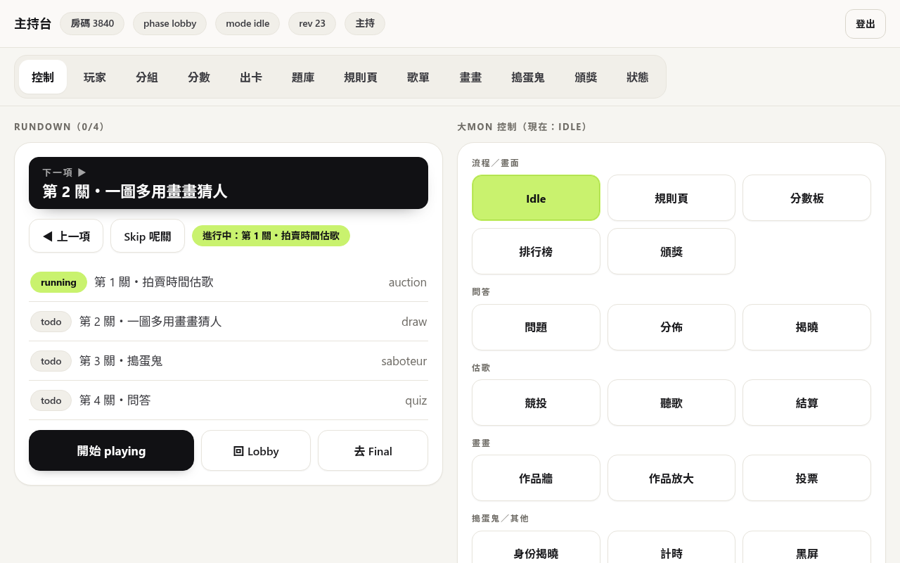

# Blunder_Operation

> 一個為生日派對而設嘅本地多人派對遊戲平台：**一個後端、三個前端（大mon／主持台／手機）、四關遊戲、一套 6 種卡嘅引擎**。
> 派對主題：**《關於我初試策劃圍威喂這檔事》**
> 現時版本：**v0.2.0**（Doubao 淺色視覺 ＋ 大mon 專用字體）

## 呢個 repo 係咩

- 全部 TypeScript（strict）＋ Node 26 LTS（fastify + @fastify/websocket + @fastify/static），單 process。
- 部署目標：Windows server Docker，host port `30005` → 容器 `3000`；對外經 Cloudflare Tunnel。
- 四關遊戲：**拍賣估歌／畫畫猜人／搗蛋鬼／常識問答**；每關有規則頁（大mon 入關自動顯示、後台可編輯）。
- 計分＝**事件帳簿**（加錯用 void 標記作廢，唔刪紀錄）；JSONL journal（manifest＋segment＋sha256＋fsync）做唯一真相，重啟 replay。
- 手機只做單向提交（投票／問答／出價），大mon 唯讀，主持台係唯一可以改大mon 嘅人。

## 功能一覽

| 模組 | 內容 |
|---|---|
| 入場 | 手機掃 QR／用房碼入場，自訂名＋emoji 頭像，主持 approve |
| 計分帳簿 | 逐筆 event、undo／void、換組（跟人走／留原組）、每關 checkpoint、`/api/host/export` CSV＋room.json |
| 問答關 | 題庫資料化（`data/quiz.seed.json`，20 題 seed）、question→tally→reveal、MC 20 秒自動收卷、open 評分、Q14 時間題自動計、重開題 roundId void |
| 估歌關 | 密封出價（stage 只出人數）、同價先交者贏、結算 §5.1、media deck＋AudioLease（單一音源／離線接管／防雙響） |
| 畫畫關 | 上載作品牆、vote 最似、主持評分、magic bytes／size／quota 檢查 |
| 搗蛋鬼 | 版本 A（潛伏者）：身份只送本人、兩輪投票、淘汰、平票裁決、計分 |
| 收尾 | finale、頒獎三獎（最高分／最接近中位數／最低分）、常駐分數條、PWA meta |
| 穩定度 | WS 自動重連＋resync、clock offset（≤0.5s）、commandId 冪等、5 個連線 cap、production 拒啟動檢查 |

## 架構

```
手機 /play ─┐
大mon /stage ├── WSS /ws（hello 首訊息帶 token） ── 單 process
主持 /host ─┘         │
                     ├── HTTP: /api/join /api/health /api/ready /api/host/*
                     ├── JSONL journal（data/journal/room-*/）
                     └── media（data/media/）
```

- `/stage` `/play` `/ws` 公開；`/host` 同 `/api/host/*` 由 Cloudflare Access＋PIN 雙重保護。
- 狀態機主從：`open → close → tally → reveal`；公開 DTO 同 server 私有模型分開（role-filtered view）。
- 詳細規格：[`docs/PLAN-v3.1.md`](docs/PLAN-v3.1.md)（唯一權威，969 行，D1–D34）、[`docs/00-INDEX.md`](docs/00-INDEX.md)。

## 快速開始（本機）

```bash
cd platform
npm ci
npm run build
cp .env.example .env      # 設 PIN（6–12 位數字，唔准用 000000 等 default）
npm start                 # http://localhost:3000/stage  /host  /play
```

測試：

```bash
npm test                  # unit（journal／計分／頒獎邊界…）
node bots/bots.mjs        # 30 bots 併發驗收（M0）
node bots/m1.mjs          # 問答關驗收（M1）
node bots/m2.mjs          # 估歌＋media deck（M2）
node bots/m3.mjs          # 畫畫（M3）
node bots/m4.mjs          # 搗蛋鬼（M4）
node bots/m5.mjs          # finale／頒獎／export（M5）
```

## Docker 部署（Windows server）

```bash
# server 上
cd C:\Users\<user>\hbd\platform
docker compose up -d --build        # ports: 30005:3000
docker compose ps                   # healthy
curl http://127.0.0.1:30005/api/ready
```

- `Dockerfile`：multi-stage（`node:26-alpine` build → runtime 只帶 `dist/`＋production deps）。
- `docker-compose.yml`：`30005:3000`、`./data` `./media` volume、`restart: unless-stopped`、healthcheck `/api/ready`。
- Runbook（起機／PIN／房碼／checkpoint／熱點後路／Cloudflare 上線清單）：[`platform/RUNBOOK.md`](platform/RUNBOOK.md)。

## 驗收紀錄

`evidence/` 入面係每個 milestone 嘅原始測試 log（本機＋部署機各跑一次）：

| Milestone | 結果 |
|---|---|
| M0 骨架＋部署底 | bots 22/22、fault injection 5/5、skew 極差 101ms（對照 3000ms） |
| M1 問答＋規則頁 | 28/28 |
| M2 估歌＋media deck | 22/22 |
| M3 畫畫 | 10/10 |
| M4 搗蛋鬼 | 9/9 |
| M5 finale／頒獎／export | 11/11 |

`check/` 入面係真模型（GLM-5.3／deepseek-v4-pro）逐個 milestone 嘅 code review 同最終 audit（每份報告第一行都有 `<!-- llm-call-meta -->` 記低 response_model／finish_reason）。

## Screenshots

| 大mon | 手機 |
|---|---|
|  |  |

| 主持台 | 題庫編輯器 |
|---|---|
|  |  |


## 目錄

```
platform/      # app（TypeScript／Docker）
  src/server   # fastify、WS hub、journal、commands、views
  src/client   # stage／host／play 三端
  bots/        # 30 bots 驗收腳本（M0–M5）
  scripts/     # seed／manifest
docs/          # PLAN-v3.1（唯一權威規格）、索引、交付報告
evidence/      # 每個 milestone 原始測試 log
check/         # 模型 review／audit 報告
screenshots/   # 三端截圖
```

## Version

**v0.1.1** — 首個公開版本：四關遊戲、規則頁、計分帳簿、Docker 部署、Cloudflare Tunnel 對外。

## 備註

- 派對題目（quiz 內容）設計成純資料，換題唔使改 code。
- 本 repo 唔包含任何真實 PIN、密碼或憑證；部署時自己設 `.env`。
